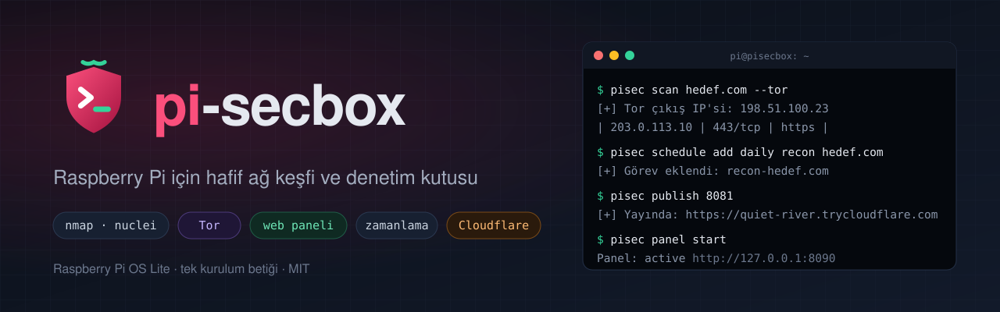
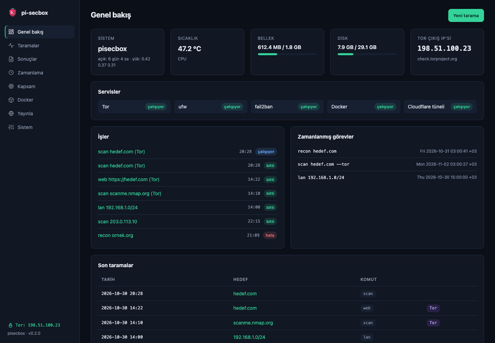
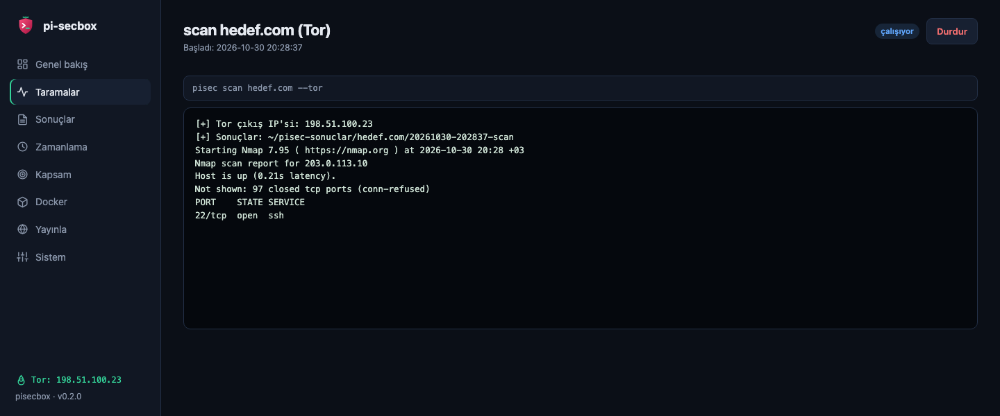

<p align="center">
  
</p>

<p align="center">
  <a href="https://github.com/gorkemguler/pi-secbox/actions/workflows/ci.yml"></a>
  <a href="LICENSE"></a>
  <a href="README.md"></a>
</p>

A setup script that turns a fresh Raspberry Pi OS Lite install into a small network
reconnaissance and security auditing box, a single command (`pisec`) to drive the tools,
and an optional web panel to manage it all from a browser.

The command line output, the panel and the detailed docs are in Turkish. This page is a
short English overview.

Kali or Parrot on a Pi works, but they ship hundreds of tools, a desktop and many
services; on a Pi you pay for that in SD card space, RAM and heat. pi-secbox goes the
other way: start from Raspberry Pi OS Lite and add only the tools you actually use.

<p align="center">
  
  
</p>

## What you get

- **Tools:** nmap, tcpdump, tshark, nuclei, subfinder, httpx, naabu, dnsx, testssl.sh,
  Tor, torsocks, proxychains4, macchanger, tmux. ProjectDiscovery tools come as prebuilt
  binaries through pdtm, so nothing is compiled on the Pi.
- **`pisec`:** runs those tools with sane flags.
  - Saves every run to a dated folder with a summary.
  - Compares each run with the previous one and lists new subdomains and new open ports.
  - Asks for confirmation before touching a target that is not on your scope list.
- **Tor mode (`--tor`):** closes the usual leaks.
  - nmap runs as a connect scan through proxychains, and raw-socket options are refused.
  - Hostnames are resolved through Tor, and testssl.sh is told not to do its own DNS lookups.
  - nuclei runs HTTP templates only, with interactsh off.
  - Every run gets its own Tor circuit.
- **Scheduled scans** through systemd timers, with optional push notifications via
  [ntfy](https://ntfy.sh).
- **Cloudflare publishing:** expose a local web app without port forwarding, either on a
  temporary `trycloudflare.com` address or through a named tunnel on your own domain.
- **Web panel:** start and watch scans live, browse results, manage schedules, the scope
  list, Docker containers and Cloudflare tunnels.
  - It listens on `127.0.0.1` only and has no free-form shell.
  - Access it through an SSH tunnel, or through Cloudflare Tunnel with Cloudflare Access
    in front.
- **Hardening:** ufw (incoming denied, SSH rate-limited), fail2ban for SSH, Docker ports
  bound to `127.0.0.1` because Docker bypasses ufw.

## Install

Flash **Raspberry Pi OS Lite (64-bit)** with Raspberry Pi Imager, enable SSH, boot, then:

```bash
sudo apt install -y git
git clone https://github.com/gorkemguler/pi-secbox.git
cd pi-secbox
./setup.sh          # tools and pisec
./setup.sh --all    # plus web panel, Docker and cloudflared
```

The script is idempotent; rerun it after `git pull` to update. `./uninstall.sh --dry-run`
shows what removal would do.

Tested on a Raspberry Pi 4 Model B (2 GB) with Raspberry Pi OS Lite 64-bit (Debian 13).

## Usage

```bash
pisec scope add example.com
pisec scan example.com --tor
pisec recon example.com
pisec web https://example.com
pisec schedule add daily recon example.com
pisec publish 8081
```

See [docs/pisec.md](docs/pisec.md) and [docs/panel.md](docs/panel.md) (Turkish) for
details, [ROADMAP.md](ROADMAP.md) for what is next.

## Legal

Only scan systems you own or have written permission to test.

## License

[MIT](LICENSE)
