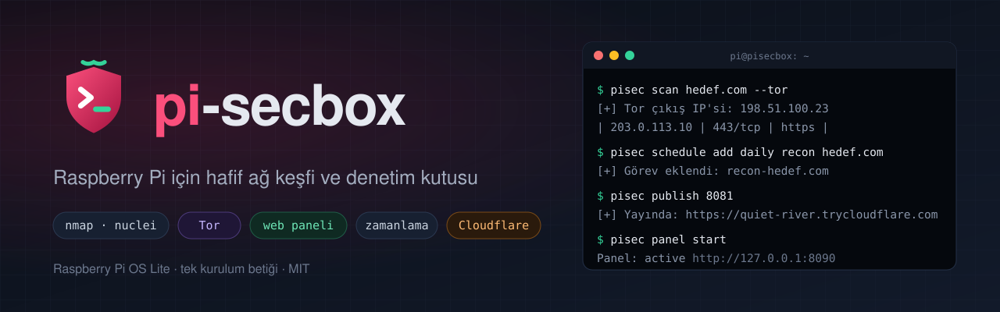
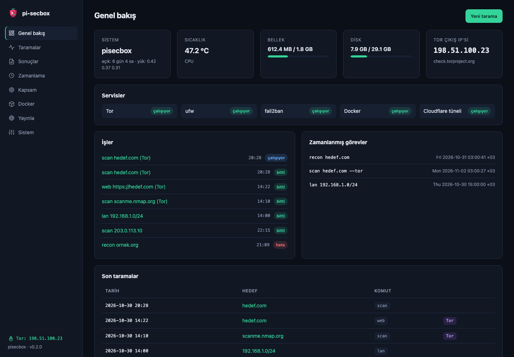
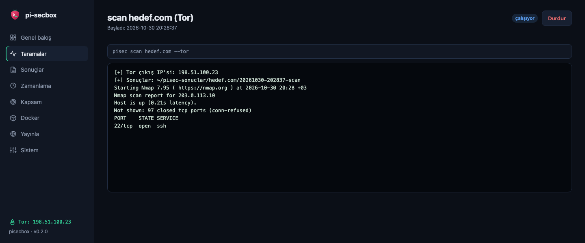
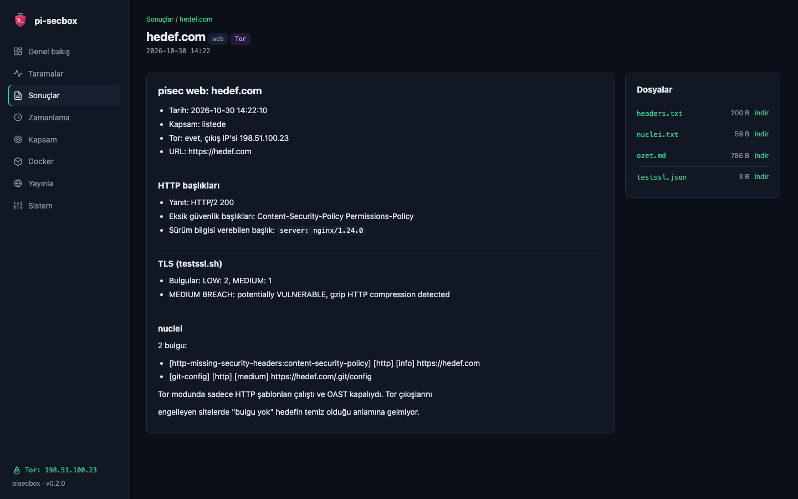
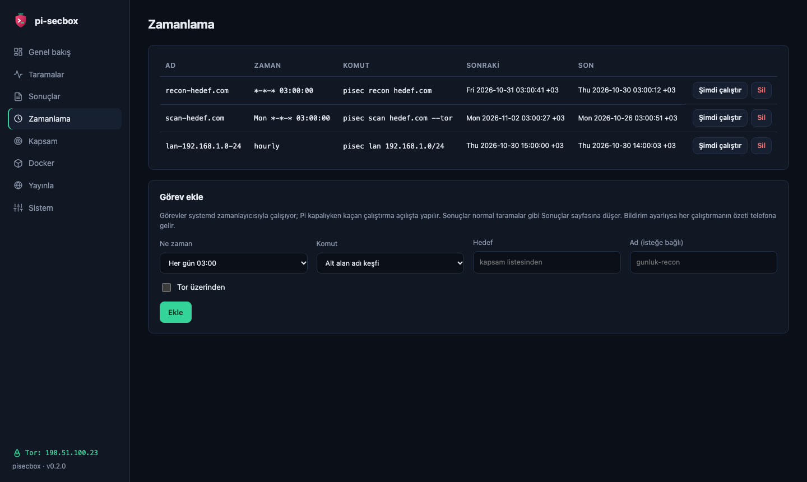
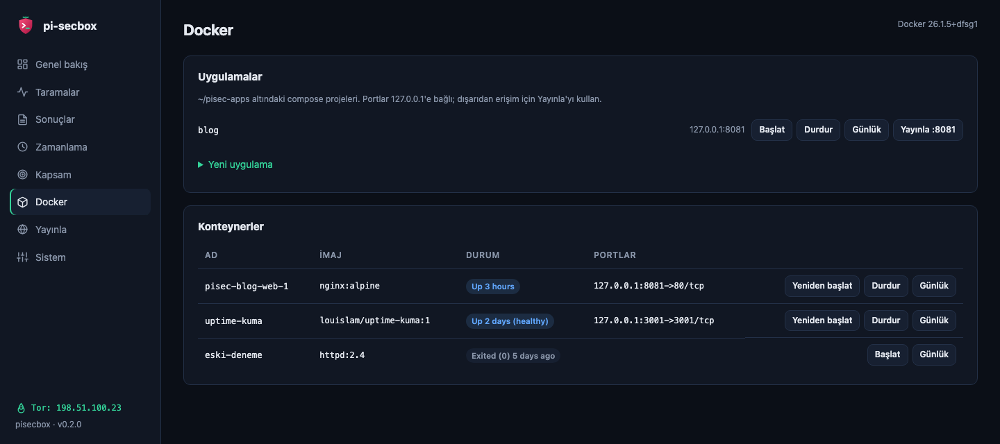
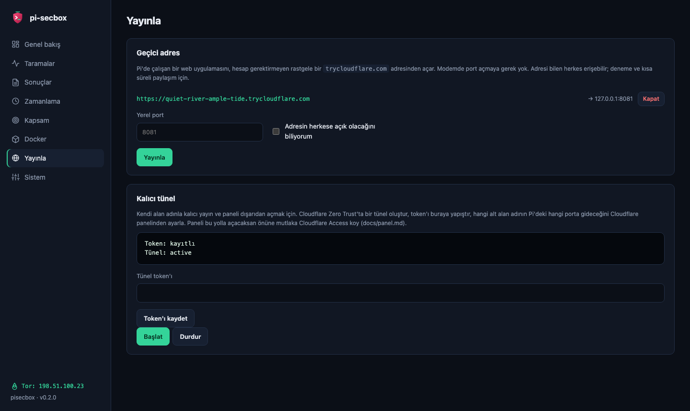

<p align="center">
  
</p>

<p align="center">
  <a href="https://github.com/gorkemguler/pi-secbox/actions/workflows/ci.yml"></a>
  <a href="LICENSE"></a>
  
  <a href="README.en.md"></a>
</p>

Raspberry Pi OS Lite üzerine küçük bir ağ keşfi ve güvenlik denetimi araç seti kuran
bir betik, bu araçları tek komuttan kullanmak için `pisec` ve her şeyi tarayıcıdan
yönetmek için isteğe bağlı bir web paneli.

Kali ya da Parrot'u Pi'ye yazmak mümkün ama yüzlerce araç, masaüstü ortamı ve bir sürü
servisle geliyorlar. Pi'de bunun bedeli SD kart, RAM ve ısı olarak ödeniyor, araçların
çoğu da hiç açılmıyor. Burada yaklaşım tersi: temiz bir Raspberry Pi OS Lite kur,
`setup.sh` ile sadece gerçekten kullanılan araçları ekle.

<table>
  <tr>
    <td></td>
    <td></td>
  </tr>
  <tr>
    <td align="center"><sub>Genel bakış: sistem, servisler, Tor çıkış IP'si, son taramalar</sub></td>
    <td align="center"><sub>Panelden başlatılan taramanın canlı çıktısı</sub></td>
  </tr>
  <tr>
    <td></td>
    <td></td>
  </tr>
  <tr>
    <td align="center"><sub>Web denetimi özeti: başlıklar, TLS, nuclei</sub></td>
    <td align="center"><sub>Zamanlanmış taramalar (systemd timer)</sub></td>
  </tr>
  <tr>
    <td></td>
    <td></td>
  </tr>
  <tr>
    <td align="center"><sub>Docker uygulamaları ve konteynerler</sub></td>
    <td align="center"><sub>Cloudflare ile yayınlama</sub></td>
  </tr>
</table>

<sub>Ekran görüntüleri panelin demo modundan, örnek verilerle (`panel/demo/run.sh`).</sub>

## Neler var

**Araçlar.** nmap, tcpdump, tshark, nuclei, subfinder, httpx, naabu, dnsx, testssl.sh,
whois, dig, Tor, torsocks, proxychains4, macchanger, tmux. ProjectDiscovery araçları
[pdtm](https://github.com/projectdiscovery/pdtm) ile hazır binary olarak geliyor; Pi'de
Go derlemek gerekmiyor.

**`pisec`.** Araçları doğru bayraklarla çalıştıran tek komut.

- `--tor` verildiğinde IP'ni ya da DNS sorgularını sızdıracak adımları kapatıyor
- Her çalıştırmayı tarihli bir klasöre `ozet.md` ile kaydediyor
- Önceki taramayla karşılaştırıp yeni alt alan adlarını ve yeni açılan portları gösteriyor
- İzinli hedef (kapsam) listesi dışındaki hedefte onay istiyor

Ayrıntılar: [docs/pisec.md](docs/pisec.md)

**Zamanlanmış taramalar ve bildirim.** `pisec schedule add daily recon hedef.com` her
gece keşif yapar, [ntfy](https://ntfy.sh) ayarlıysa sonucu telefonuna gönderir.

**Web paneli.** Tarama başlatma ve canlı izleme, sonuçlar, zamanlama, kapsam, Docker
konteynerleri ve Cloudflare yayınları tek yerden. Sadece `127.0.0.1`'de dinliyor, serbest
komut satırı yok. Ayrıntılar: [docs/panel.md](docs/panel.md)

**Cloudflare ile yayınlama.** Pi'deki bir web uygulamasını modemde port açmadan
dışarıya açmak için `pisec publish 8081` geçici bir `trycloudflare.com` adresi verir.
Kendi alan adınla kalıcı yayın için `pisec tunnel`.

**Sıkılaştırma.**

- ufw gelen bağlantıları kapatıyor; SSH portunu açık bırakıyor, hız sınırıyla.
- fail2ban SSH'ye kaba kuvvet denemelerini engelliyor.
- Docker konteynerleri sadece `127.0.0.1`'e bağlanıyor.

## Kurulum

### 1. SD kartı hazırla

[Raspberry Pi Imager](https://www.raspberrypi.com/software/) ile **Raspberry Pi OS Lite
(64-bit)** yaz. Özelleştirme adımında:

- hostname ver (ör. `pisecbox`)
- kullanıcı adı ve parola belirle
- Wi-Fi kullanacaksan ağ adı, parola ve ülke kodunu gir
- SSH'yi aç, mümkünse parola yerine açık anahtar ile
- Imager sürümünde Raspberry Pi Connect seçeneği varsa onu da aç

Kartı takıp Pi'yi başlat, birkaç dakika sonra `ssh kullanici@pisecbox.local` ile bağlan.

### 2. Betiği çalıştır

```bash
sudo apt install -y git
git clone https://github.com/gorkemguler/pi-secbox.git
cd pi-secbox
./setup.sh             # sadece araçlar ve pisec
./setup.sh --all       # panel, Docker ve cloudflared da
```

| Seçenek | Ne yapıyor |
|---|---|
| `--no-upgrade` | `apt full-upgrade` adımını atlar |
| `--no-firewall` | ufw ayarlarına dokunmaz |
| `--with-panel` | Web panelini kurar, parolasını sorar, kullanıcı servisi olarak başlatır |
| `--with-docker` | `docker.io` ve compose'u kurar, kullanıcıyı `docker` grubuna ekler |
| `--with-cloudflared` | Cloudflare'ın apt deposunu ekleyip `cloudflared` kurar |
| `--all` | Son üçü birden |

Betik tekrar çalıştırılabilir; ikinci çalıştırmada araçları günceller, ayarları ikinci
kez eklemez. Depoyu `git pull` ile güncelledikten sonra `./setup.sh --no-upgrade`
yeterli. Kullanıcı yeni gruplara (`debian-tor`, `docker`) eklendiyse betik sonunda Pi'yi
yeniden başlatmanı ister.

### Gereksinimler

- 64-bit Raspberry Pi OS Lite. Debian tabanlı başka sistemlerde de çalışması gerekir,
  sadece Pi Connect adımı atlanır.
- `sudo` yetkisi olan normal bir kullanıcı. Betik root olarak çalıştırılırsa durur.
- İnternet bağlantısı ve SD kartta yaklaşık 1 GB boş alan (Docker ile 1,5 GB).

Test edildiği ortam: Raspberry Pi 4 Model B (2 GB), Raspberry Pi OS Lite 64-bit
(Debian 13 Trixie), Wi-Fi. Bookworm ve 32-bit sistemlerde denenmedi.

## Kullanım

```bash
pisec scope add hedef.com              # önce hedefi izinli listeye ekle

pisec tor status                       # Tor çalışıyor mu, çıkış IP'si ne
pisec lan                              # yerel ağdaki cihazlar
pisec scan hedef.com --tor             # Tor üzerinden port taraması
pisec recon hedef.com                  # alt alan adları ve canlı web servisleri
pisec web https://hedef.com            # HTTP başlıkları, TLS ayarları, nuclei
pisec results hedef.com                # son çalıştırmanın özeti

pisec schedule add daily recon hedef.com
pisec notify set https://ntfy.sh/<tahmin-edilmesi-zor-bir-konu>
pisec publish 8081                     # 127.0.0.1:8081'i geçici bir adresten aç
pisec panel                            # panelin durumu ve adresi
```

Argümansız `pisec` çalıştırınca hedefi ve Tor tercihini soran bir menü açılır. Araçları
doğrudan kullanmak için komut notları [`cheatsheet.md`](cheatsheet.md) içinde ve kurulumdan
sonra `~/pisecbox-cheatsheet.md` olarak duruyor.

Uzun süren taramaları `tmux` içinde ya da panelden başlat; SSH bağlantısı koparsa tarama
devam eder.

## Bilmen gerekenler

**Tor sadece TCP taşır.** proxychains, programın açtığı TCP bağlantılarını Tor'a
yönlendirir. Ping, UDP ve ham soket kullanan her şey (`nmap -sS`, `nmap -sU`, `dig`)
doğrudan senin IP'nden çıkar. `pisec --tor` bu seçenekleri reddediyor; araçları elle
çalıştırırken nmap için `-sT -Pn -n` üçlüsünü unutma.

**Sistemin tüm trafiğini Tor'a zorlama.** iptables ile her şeyi Tor'a yönlendiren
araçlar (transparent proxy) Pi Connect'i ve Cloudflare tünelini koparır. Sadece
çalıştırdığın komutu Tor'dan geçir.

**testssl.sh DNS sızdırır.** Adres çözümlemesi için `dig`/`host` çağırdığından
proxychains ile çalıştırıldığında bile DNS sorguları Tor dışından gider. `pisec web
--tor` adresi Tor üzerinden çözüp testssl'e `--ip` ve `--nodns none` ile vererek bunu
önlüyor.

**Docker portları ufw'yi atlar.** Docker kendi iptables kurallarını ufw'den önce
yazıyor; `8080:80` gibi bir eşleme ufw kapalı dese de portu ağa açar. Panel bu yüzden
`127.0.0.1:` ile başlamayan port eşlemelerini kabul etmiyor.

**Grup üyelikleri root'a yakın yetki verir.** `docker` grubu root'a denk; `debian-tor`
grubu Tor'u yeniden yapılandırabilir. Pi'yi tek kişi kullanıyorsa sorun değil, ama
bilerek aç.

## Kaldırma

```bash
./uninstall.sh --dry-run    # ne yapılacağını göster
./uninstall.sh
```

`setup.sh`'ın yaptıklarını geri alır: `pisec`, panel, zamanlanmış görevler, tüneller,
testssl.sh, ProjectDiscovery araçları, nuclei şablonları, `.bashrc` satırları (eski hali
`~/.bashrc.pisecbox-yedek` olarak saklanır), proxychains4 ayarı (`.orig` yedeğinden),
fail2ban ayarı, `debian-tor` grup üyeliği. ufw'yi kapatır; açık kalsın istersen
`--keep-firewall`.

Varsayılan olarak apt paketlerine ve kullanıcı verisine dokunmaz:

- `--packages`: nmap, tor, ufw, fail2ban, cloudflared gibi paketleri de kaldırır. git,
  curl, jq gibi genel araçlar, Docker ve Pi Connect yerinde kalır.
- `--purge`: tarama sonuçlarını, kapsam listesini, panel ayarlarını, Cloudflare token'ını,
  `~/pisec-apps`'i ve araçların ayar klasörlerini (subfinder API anahtarları dahil) siler.

## Geliştirme

Testler gerçek araçları çalıştırmıyor: `pisec`, `setup.sh` ve `uninstall.sh` için
[bats](https://github.com/bats-core/bats-core) testleri `test/mock` ile, panel testleri
`panel/demo/bin` altındaki sahte araçlarla çalışıyor. Ağa çıkılmıyor, HOME geçici bir
dizine alınıyor. GitHub Actions her push'ta shellcheck, bats ve panel testlerini koşuyor.

```bash
sudo apt install bats shellcheck python3-flask python3-waitress
bats test/
python3 -m unittest discover -s panel/tests
panel/demo/run.sh            # paneli örnek verilerle http://127.0.0.1:8099'da aç
```

Ayrıntılar [CONTRIBUTING.md](CONTRIBUTING.md) içinde. Sıradaki işler:
[ROADMAP.md](ROADMAP.md). Değişiklikler: [CHANGELOG.md](CHANGELOG.md).

## Yasal uyarı

Bu araçları sadece sahibi olduğun ya da yazılı test izni aldığın sistemlerde kullan.
İzinsiz tarama ve zafiyet denetimi birçok ülkede suç. Kapsam listesi bu yüzden var:
listede olmayan hedefe `pisec` onay almadan, panel ve zamanlanmış görevler hiç başlamıyor.

Güvenlik açığı bildirimi için [SECURITY.md](SECURITY.md).

## Lisans

[MIT](LICENSE)
